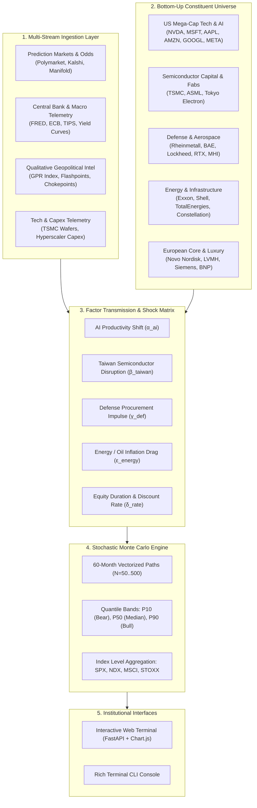

# 🌐 Titan OmniMacro: 5-Year Geopolitical & Quantitative Projection Engine

An institutional-grade quantitative forecasting and multi-scenario simulation engine designed to project **5-Year dynamics (2026–2031)** across major global equity benchmarks:
- **S&P 500 (`SPX`)**
- **Nasdaq 100 (`NDX`)**
- **MSCI World (`URTH` / Developed World)**
- **STOXX Europe 600 (`SXXP`)**

The engine synthesizes **macroeconomics, central bank policy, geopolitical intelligence, prediction market collective odds ("gambling" feeds), and tech supply chain telemetry** directly into **bottom-up constituent financial models** across individual components.

---

## 🏛️ System Architecture



---

## ⚡ Key Geopolitical & Tech Scenarios Modeled

| Scenario ID | Name | Core Catalysts & Transmission |
| :--- | :--- | :--- |
| `composite_polymarket` | **Polymarket Ensemble (Live)** | Dynamically probability-weighted using active betting odds across Taiwan, AI, Ukraine, and Middle East. |
| `ai_hyper_supercycle` | **AI Supercycle & AGI** | +350 bps enterprise software margin expansion; hyper-capex for power grids (CEG), ASICs, and server infrastructure. |
| `ai_capex_winter` | **AI ROI Disappointment** | Cloud capex cuts of 20-30%; chip inventory digestion; multiple de-rating across tech heavyweights. |
| `taiwan_semiconductor_blockade` | **Taiwan Strait Conflict** | Naval quarantine/blockade cuts 75% of advanced global wafers (3nm/2nm). Extreme supply chain shock; defense surges (RHM, LMT). |
| `mideast_hormuz_oil_shock` | **Strait of Hormuz Closure** | Regional war halts tanker traffic. Brent crude spikes to $135+/bbl; stagflation hits Western economies; energy supermajors (XOM, SHEL) surge. |
| `ukraine_ceasefire_reconstruction` | **Ukraine Peace Settlement** | Formal armistice treaties; €450B European reconstruction capex; European gas normalizes; industrials (Siemens) rally. |
| `deglobalization_tariff_war` | **Global Universal Tariffs** | US universal 15-20% tariff enacted with retaliatory tariffs from China/EU; margin compression on multinationals. |

---

## 🚀 Quickstart Guide

### 1. Launch the Interactive Web Terminal
```powershell
python start_server.py
```
Open **[http://127.0.0.1:8000](http://127.0.0.1:8000)** in your browser.

- Adjust scenario selection or tweak real-time factor shock sliders (Taiwan severity, AI productivity, Hormuz shock, Ukraine conflict).
- View 5-year Monte Carlo confidence envelopes (P10 to P90).
- Inspect individual constituent dislocations, factor attribution waterfall, and prediction market live odds.

### 2. Execute via Terminal CLI
```powershell
# Run default Polymarket ensemble simulation
python cli.py

# Inspect live prediction market odds and intelligence stream
python cli.py --show-odds --show-intel

# Stress test specific scenario (e.g. Taiwan Semiconductor Blockade)
python cli.py --scenario taiwan_semiconductor_blockade --runs 200

# Stress test AI Supercycle with custom runs
python cli.py --scenario ai_hyper_supercycle --runs 250
```

---

## 📊 Constituent Factor Exposure Matrix (Sample)

| Symbol | Name | Index | Taiwan Dep. | AI Score | Energy Sens. | Defense Boost | Equity Duration |
| :--- | :--- | :--- | :---: | :---: | :---: | :---: | :---: |
| **NVDA** | NVIDIA Corp | NDX / SPX | **96%** | **+0.98** | -0.08 | +0.15 | 1.6x |
| **AAPL** | Apple Inc. | NDX / SPX | **92%** | +0.55 | -0.15 | 0.00 | 1.3x |
| **ASML** | ASML Holding | STOXX 600 | 50% | **+0.92** | -0.10 | +0.12 | 1.5x |
| **TSM** | TSMC | MSCI World | **100%** | **+0.96** | -0.22 | +0.35 | 1.4x |
| **RHM.DE** | Rheinmetall AG | STOXX 600 | 25% | +0.20 | -0.15 | **+0.98** | 0.5x |
| **LMT** | Lockheed Martin | SPX | 38% | +0.30 | -0.05 | **+0.90** | 0.7x |
| **XOM** | Exxon Mobil | SPX | 5% | +0.10 | **+0.88** | +0.15 | 0.3x |
| **SHEL.L** | Shell plc | STOXX 600 | 6% | +0.08 | **+0.85** | +0.12 | 0.2x |
| **CEG** | Constellation Energy | SPX | 5% | **+0.88** | **+0.45** | +0.10 | 1.1x |
| **MC.PA** | LVMH | STOXX 600 | 8% | +0.10 | -0.12 | -0.10 | 1.1x |

---

## 📈 Quant v3: Institutional Multi-Asset Trajectory & Term Structure Engine

Accessible via **`http://127.0.0.1:8000/quant`** or programmatically via `/api/v3/*`:

1. **Dynamic Nelson-Siegel Yield Curve (Diebold-Li 2006)**:
   - Level, Slope, and Curvature state estimation on US Treasury yields ($0.25\text{Y}$ to $30\text{Y}$).
   - Stationary VAR(1) factor evolution with residual bootstrap simulation.
2. **3-State Gaussian Hidden Markov Model (HMM)**:
   - Unsupervised macro regime estimation (*Calm*, *Normal*, *Stress*) across global market factors.
   - Vectorized Baum-Welch in log-space, forward-backward smoother, and Viterbi decoding.
3. **Hybrid Macro + Statistical Factor Model**:
   - Cross-sectional OLS across observable macro risk factors (`MKT`, `USD`, `RATES`, `OIL`, `COPPER`, `GOLD`, `CREDIT`, `EM`).
   - SVD Principal Component Analysis (PCA) on residuals extracting latent statistical risk drivers.
4. **Index Reconstitution & IPO Pipeline**:
   - Nasdaq-100 Monte Carlo buffer rule evaluation (rank 100/125 logic).
   - S&P 500 addition scoring (market cap threshold, trailing 4-quarter GAAP net income profitability, IPO seasoning).
5. **Portfolio Rebalancing Protocol (Swensen 5/25 Corridors)**:
   - Drift-band trigger mechanics: $\pm 5.0\%$ absolute or $\pm 25\%$ relative deviation.
   - Passive DCA rebalancing algorithm optimizing cash injection to eliminate tax and bid-ask frictions.

---

## 🧪 Automated Test Suite
```powershell
python tests/quant/test_data.py
python tests/quant/test_web.py
python tests/test_engine.py
python tests/test_api.py
```
All suites run without external machine-learning dependencies (pure `numpy`, `pandas`, `scipy`).

